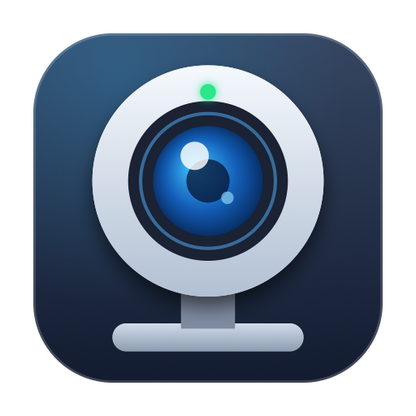
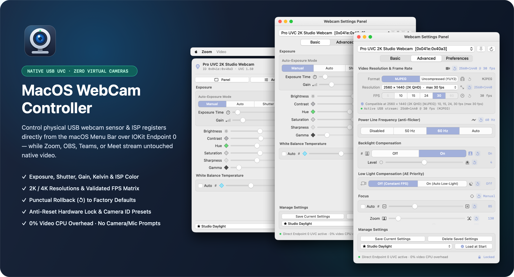
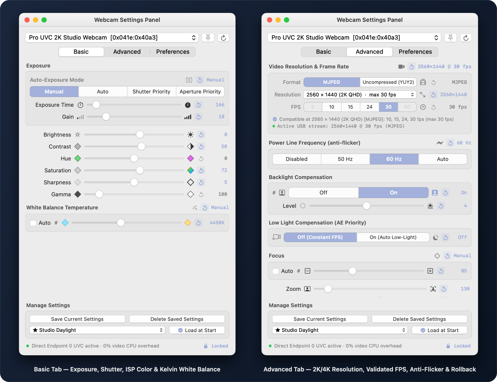
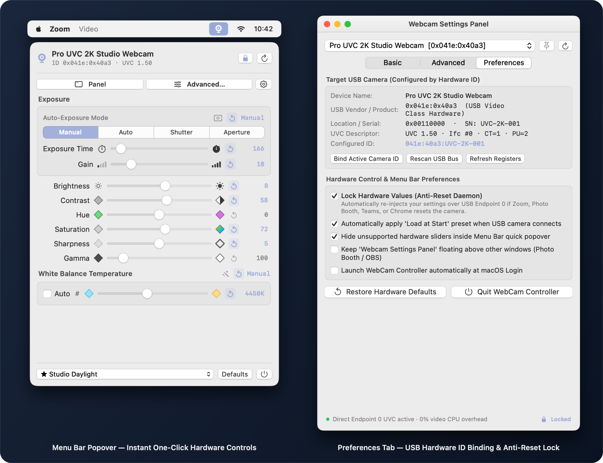
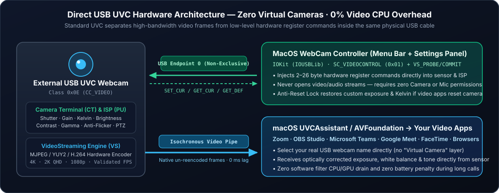

<div align="center">



# MacOS WebCam Controller

**Direct USB UVC Hardware Control from the macOS Menu Bar — Zero Virtual Cameras · 0% Video CPU Overhead**

[](https://github.com/SilverFeit/MacOS-WebCam-Controller/releases/latest)
[-111827?style=flat-square&logo=apple)](https://github.com/SilverFeit/MacOS-WebCam-Controller/releases/latest)
[-10b981?style=flat-square)](#how-direct-usb-hardware-control-works)
[](#privacy--security-by-design)
[](LICENSE)

[**Download Latest `.dmg`**](https://github.com/SilverFeit/MacOS-WebCam-Controller/releases/latest) · [**Features**](#key-features) · [**Why Not Virtual Cameras?**](#why-direct-hardware-beats-virtual-cameras) · [**Architecture**](#how-direct-usb-hardware-control-works) · [**User Guide**](docs/USER_GUIDE.md) · [**Español**](#-español--resumen-del-proyecto)

<br />



</div>

---

## Overview

**MacOS WebCam Controller** is a lightweight native macOS menu-bar utility (`Swift` + `SwiftUI` + `C / IOKit`) that unlocks **physical sensor and ISP hardware registers** on external USB webcams compliant with the **UVC (USB Video Class)** standard.

On Windows, operating system APIs (`DirectShow` / `IAMCameraControl`) expose every USB webcam's hardware control panel out of the box. On macOS, `AVFoundation` captures video frames from external USB cameras while ignoring their UVC control descriptors (`isExposureModeSupported(.custom)` returns `false`, and `uvcassistantextension` hides UVC control entities). As a result, most Mac tools resort to heavy **virtual cameras** that apply software filters on top of an already overexposed, motion-blurred, or color-shifted image.

**MacOS WebCam Controller takes the pure hardware path:** it communicates directly with your webcam's internal sensor and Image Signal Processor (ISP) over **USB Endpoint 0** via `IOKit` (`IOUSBLib`) in real time — while **Zoom, OBS Studio, Microsoft Teams, Google Meet, Webex, FaceTime, or Chrome** continue consuming the native camera feed with **zero virtual cameras, zero video latency, and 0% video re-encoding CPU/GPU drain**.

<details>
<summary><strong>🇪🇸 Español — Resumen del Proyecto (Haz clic para desplegar)</strong></summary>

<br />

**MacOS WebCam Controller** es una aplicación nativa para la barra de menús de macOS (Apple Silicon) diseñada para modificar **físicamente los registros internos del sensor y del procesador de imagen (ISP)** de cualquier cámara web externa USB compatible con el estándar **UVC (USB Video Class)**.

- **100% Hardware Real (Sin Cámaras Virtuales):** En Zoom, Meet, Teams, OBS o FaceTime sigues eligiendo el nombre real de tu cámara USB. La app inyecta paquetes UVC (`SET_CUR`, `GET_CUR`, `GET_DEF`) por el canal lateral **Endpoint 0** mediante `IOKit` sin capturar ni recodificar fotogramas de video (`0%` de carga de video en CPU/GPU y `0 ms` de latencia).
- **Control Total desde el Menu Bar y Panel Dedicado:** Exposición manual, velocidad de obturación real, ganancia analógica, temperatura de balance de blancos en Kelvin, brillo, contraste, matiz, saturación, nitidez, gamma, filtro anti-parpadeo (`50 Hz / 60 Hz`), compensación de contraluz y baja luz, enfoque y PTZ (`Zoom`, `Pan`, `Tilt`).
- **Resoluciones (2K / 4K / 1080p) y Validación Dinámica de FPS:** Inspecciona los descriptores `SC_VIDEOSTREAMING` reales del bus USB, habilitando únicamente las tasas de cuadros (`FPS`) compatibles con cada formato (`MJPEG`, `YUY2`, `H.264`) y resolución.
- **Rollback Puntual (`↺`) en Cada Ajuste:** Cada control manual incorpora un botón `↺` situado entre el icono del control y su valor numérico para restablecer únicamente ese parámetro a su valor de fábrica (`GET_DEF`) sin alterar el resto de tu configuración.
- **Bloqueo Anti-Reseteo y Perfiles por Hardware ID:** Evita que aplicaciones de videollamadas sobrescriban tu exposición o balance de blancos al iniciar una llamada, asociando perfiles automáticos (`Load at Start`) al ID físico USB de tu cámara.

</details>

---

## Why Direct Hardware Beats Virtual Cameras

| Capability | **MacOS WebCam Controller** *(Direct USB UVC)* | Virtual Camera Software *(`CMIOExtension`)* |
| :--- | :--- | :--- |
| **Where adjustments happen** | **Inside the camera's physical CMOS sensor & ISP chip** before frames enter the USB cable | Post-processed in software after frames are already compressed & clipped |
| **Motion blur & blown highlights** | **True electronic shutter control** (e.g. `1/60s`, `1/125s`) eliminates motion blur optically | Cannot recover clipped highlights or remove sensor motion blur |
| **CPU / GPU / Battery impact** | **~0.0%** — zero video frames decoded, filtered, or re-encoded | Continuous CPU/GPU frame copying & shader rendering during calls |
| **Added video latency** | **0 ms** | 1–3 frames of pipeline buffering |
| **Device selected in Zoom / OBS / Meet** | **Your real USB webcam directly** | A synthetic *"Virtual Camera"* wrapper (often blocked in proctoring/enterprise apps) |
| **macOS Permissions & System Extensions** | **None required** (no Camera, no Mic, no System Extension) | Requires Camera TCC permission + System Extension approval |

---

## Key Features

<div align="center">

</div>

### 1. Instant Menu Bar Control + Standalone Settings Panel
- **Left-click** the webcam icon in the macOS Menu Bar to adjust primary exposure, color, and white-balance sliders on the fly during a call.
- **Right-click** the Menu Bar icon (or click **Advanced…** / **Panel**) to open the full **Webcam Settings Panel** (`Basic`, `Advanced`, and `Preferences` tabs), with optional **Pin on Top** so it floats above OBS, Zoom, or Photo Booth while you dial in your shot.

### 2. Full Sensor, ISP & Optical Control (`Basic` & `Advanced`)
- **Exposure & Gain:** Switch between hardware-supported `Manual`, `Auto`, `Shutter Priority`, and `Aperture Priority` modes; dial in exact physical **Exposure Time** (`100 µs` steps) and sensor **Gain**.
- **Color & Tone ISP Pipeline:** Hardware **Brightness**, **Contrast**, **Hue**, **Saturation**, **Sharpness**, and **Gamma**.
- **Precision White Balance:** Toggle **Auto** off to lock exact color temperature in **Kelvin** (e.g. `3200K` tungsten to `6500K` daylight).
- **Lighting & Optics:** **Power Line Frequency** (`Disabled`, `50 Hz`, `60 Hz`, `Auto` anti-flicker), **Backlight Compensation** (binary switch + multi-level fine slider when supported by hardware), **Low Light Compensation** (`AE Priority` constant-FPS vs. auto low-light), **Focus** (`Auto` + manual optical focus), **Zoom**, **Pan**, **Tilt**, **Aperture**, **Roll**, **Hardware Privacy Shutter**, and **Progressive Scan**.

### 3. Hardware Resolutions & Validated FPS Compatibility Matrix
- Reads raw `SC_VIDEOSTREAMING (0x02)` USB configuration descriptors (`VS_FORMAT_MJPEG`, `VS_FORMAT_UNCOMPRESSED`, `VS_FORMAT_FRAME_BASED`) to list every real hardware resolution (`4K UHD`, `2K QHD 2560×1440`, `1080p FHD`, `UXGA`, `720p HD`, `VGA`).
- **Dynamic FPS Compatibility Enforcement:** Validates `(Format, Resolution, FPS)` combinations against the camera's frame-interval descriptors — enabling **only** frame rates physically supported at the selected resolution (for instance, unlocking `60 fps` on `1080p` while automatically clamping to `30 fps` when switching to `2K QHD`, or clamping `MJPEG 30 fps` to `YUY2` bandwidth limits) and negotiating over USB via `VS_PROBE_CONTROL` / `VS_COMMIT_CONTROL`.

### 4. Punctual Single-Setting Rollback (`↺`)
- Every manual slider, mode selector, and stream parameter features a dedicated **Rollback (`↺`)** icon positioned directly between the control icon and its live readout.
- Clicking `↺` queries and restores **only that individual register** to its hardware factory default (`GET_DEF`) without resetting the rest of your look. Modified registers highlight in accent blue so you can see every customized parameter at a glance.

<div align="center">

</div>

### 5. Persistent USB Hardware ID Binding, Presets & Anti-Reset Lock
- **Bind by Hardware ID:** Targets your webcam by persistent USB identity (`VendorID:ProductID:SerialNumber`), surviving reboots and USB port changes.
- **Named Presets & `★ Load at Start`:** Save unlimited profiles per camera model (e.g., *Studio Daylight*, *Warm Key Light*, *Night Call*) and mark one to auto-inject the moment your USB webcam is plugged in.
- **Anti-Reset Hardware Lock Daemon:** Many UVC cameras lack non-volatile memory and reset to auto-exposure whenever a video call starts. Enabling the **Lock (`🔒`)** monitors live hardware registers in the background and silently re-injects your custom profile if another app overwrites it.

---

## How Direct USB Hardware Control Works

<div align="center">

</div>

USB Video Class (UVC) cameras split communication into two independent logical interfaces inside the same physical USB cable:

1. **Video Streaming Interface (`bInterfaceSubClass = 0x02`):** High-bandwidth isochronous/bulk pipe owned by macOS `UVCAssistant` / `AVFoundation`, delivering video frames straight to Zoom, OBS, Teams, or your browser.
2. **Video Control Interface (`bInterfaceSubClass = 0x01` — Endpoint 0):** Lightweight control channel where **MacOS WebCam Controller** sends non-exclusive `IOUSBDevRequest` packets (`GET_INFO`, `GET_MIN`, `GET_MAX`, `GET_RES`, `GET_DEF`, `GET_CUR`, `SET_CUR`) directly to the Camera Terminal (`CT`) and Processing Unit (`PU`) without claiming exclusive interface ownership (`kIOReturnExclusiveAccess` safe).

Because discovery scans the live `IOKit` USB registry directly for `bInterfaceClass == 0x0E (CC_VIDEO)` rather than slicing legacy `AVCaptureDevice.uniqueID` strings, hardware matching works reliably across modern macOS releases (**macOS 14 Sonoma**, **macOS 15 Sequoia**, and **macOS 26 / 27**).

---

## Requirements & Compatibility

- **Mac Architecture:** Apple Silicon (`arm64` — M1, M2, M3, M4, and newer). *Certified compatibility: Apple Silicon only.*
- **Operating System:** macOS 14.0 or later *(tested and verified on **macOS 27.0.1 — Build 26A434**)*.
- **Supported Cameras:** Any external UVC-compliant USB webcam (Logitech, Elgato, Creative, Razer, Insta360, Anker, Sony/Canon/Lumix UVC HDMI/USB interfaces, and generic USB 2.0/3.0 UVC webcams).
- **Not Supported:** Built-in MacBook / iMac FaceTime HD cameras (Apple Silicon built-in cameras connect to Apple's proprietary internal ISP via `appleh13camerad` rather than USB UVC). Controls not implemented by a specific USB camera's firmware are automatically shown disabled or marked `N/A`.

---

## Installation

### Option A — Download Prebuilt Release (Recommended)

1. Go to the [**Latest Release (`v1.0`)**](https://github.com/SilverFeit/MacOS-WebCam-Controller/releases/tag/v1.0).
2. Download **`MacOS-WebCam-Controller-1.0.dmg`** *(or `MacOS-WebCam-Controller-1.0.app.zip`)*.
3. Open the `.dmg` disk image and drag **WebCam Controller** into your **Applications** folder.
4. Launch **WebCam Controller** from `/Applications` — a webcam icon appears immediately in your macOS Menu Bar.

> [!NOTE]
> **First Launch on macOS (Gatekeeper):** Because this open-source build uses ad-hoc code signing rather than a paid Apple Developer ID certificate, macOS may ask for confirmation on first open. Simply **Control-click (right-click) `WebCam Controller.app` → `Open` → `Open`** (or approve it under **System Settings → Privacy & Security → Open Anyway**).
>
> Alternatively, clear the download quarantine attribute in Terminal:
> ```bash
> xattr -dr com.apple.quarantine "/Applications/WebCam Controller.app"
> ```

### Option B — Build from Source

Requires macOS 14+ with Xcode or Xcode Command Line Tools (`swift 6.0+`):

```bash
git clone https://github.com/SilverFeit/MacOS-WebCam-Controller.git
cd MacOS-WebCam-Controller

# Run the unit + live USB UVC hardware test suite
swift run UVCCoreTests

# Build Release .app, .dmg, .app.zip & SHA256SUMS.txt
./Scripts/package_release.sh 1.0

# Install to /Applications
ditto --norsrc --noextattr "dist/WebCam Controller.app" "/Applications/WebCam Controller.app"
open "/Applications/WebCam Controller.app"
```

### CLI Diagnostics

Inspect your connected USB webcam's raw UVC unit IDs, control ranges, defaults, and supported resolution/FPS descriptors directly from Terminal:

```bash
"/Applications/WebCam Controller.app/Contents/MacOS/WebcamControllerApp" --dump-hardware
```

---

## Privacy & Security by Design

- **Zero Camera Permission:** Never opens an `AVCaptureSession` and never reads a single pixel of your video feed.
- **Zero Microphone Permission:** Never accesses audio interfaces.
- **Zero Network Calls / Telemetry:** Runs 100% offline with local `UserDefaults` preset storage.
- **Zero Kernel / System Extensions:** Communicates strictly via standard user-space `IOKit` Endpoint 0 control requests.

For complete documentation of every tab, preset workflow, and hardware lock option, read the [**Full User Guide (`docs/USER_GUIDE.md`)**](docs/USER_GUIDE.md).

---

## Project Structure

```text
MacOS-WebCam-Controller/
├── Package.swift                        # SwiftPM manifest (CUVCHardware + UVCCore + App + Tests)
├── Sources/
│   ├── CUVCHardware/                    # Pure C11 IOKit / IOUSBLib UVC Endpoint 0 & descriptor engine
│   ├── UVCCore/                         # Swift 6 device introspection, FPS validator, presets & lock daemon
│   └── WebcamControllerApp/             # Native AppKit NSStatusItem + SwiftUI Menu Bar & Settings Panel
├── Tests/UVCCoreTests/                  # Unit + live USB hardware register read/write verification suite
├── Scripts/                             # App bundle builder, Retina .icns generator & DMG release packager
└── docs/                                # User Guide, Retina UI screenshots & vector USB architecture diagram
```

---

## License

Released under the [MIT License](LICENSE). Copyright © 2026 [SilverFeit](https://github.com/SilverFeit).

---

<div align="center">

**Topics & Hashtags**

`#macOS` `#WebcamController` `#UVC` `#USBCamera` `#WebcamSettings` `#MenuBarApp` `#AppleSilicon` `#SwiftUI` `#IOKit` `#HardwareControl` `#ManualExposure` `#WhiteBalance` `#OBSStudio` `#Zoom` `#VideoConferencing` `#StreamingTools` `#MacUtilities` `#OpenSource`

</div>
