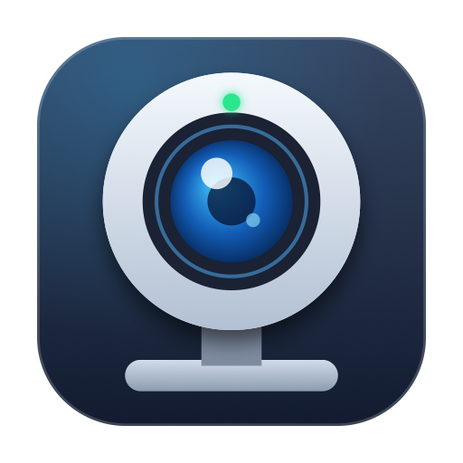
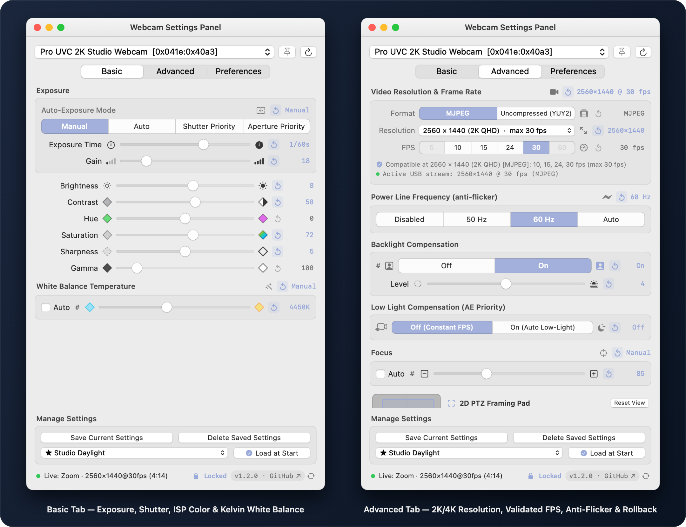

<div align="center">



# MacOS WebCam Controller — User Guide

**Version 1.2.0 · Direct USB UVC Hardware Control + WebSocket API + `webcamctl` CLI for Apple Silicon Macs**

</div>

MacOS WebCam Controller changes the physical hardware settings of an external USB webcam directly from the macOS Menu Bar, from the standalone **Webcam Settings Panel**, and from Terminal via **`webcamctl`**. It never opens a video capture session and never requests Camera or Microphone permissions. Every adjustment writes directly to your webcam's internal sensor and ISP over USB Endpoint 0 for whichever app (Zoom, OBS, Teams, Meet, FaceTime, WhatsApp, or Chrome) is displaying your camera.

<p align="center">
  
</p>

## Requirements

- **Apple Silicon Mac** (`arm64` — M1, M2, M3, M4, or newer).
- **macOS 14 Sonoma or later** *(verified through **macOS 27.0.1**)*.
- **External USB UVC webcam.** Built-in MacBook/iMac FaceTime cameras use Apple's internal ISP rather than USB UVC and are not controlled by this app.

## Install & Update

### Option 1 — Homebrew (Recommended)

Installs both **`/Applications/WebCam Controller.app`** and **`/opt/homebrew/bin/webcamctl`**, and clears Gatekeeper quarantine automatically:

```bash
brew install --cask SilverFeit/tap/macos-webcam-controller
```

Upgrade whenever a new release is available:

```bash
brew upgrade --cask macos-webcam-controller
```

### Option 2 — Direct `.dmg` or `.zip` Download

1. Download `MacOS-WebCam-Controller-1.1.1.dmg` from [GitHub Releases](https://github.com/SilverFeit/MacOS-WebCam-Controller/releases/latest).
2. Open the disk image and drag **WebCam Controller** onto **Applications**.
3. On first launch of a manual download, Control-click **WebCam Controller.app** → **Open** → **Open** (or run `xattr -dr com.apple.quarantine "/Applications/WebCam Controller.app"`).
4. Optional — symlink the bundled CLI into `/opt/homebrew/bin`:
   ```bash
   ln -sf "/Applications/WebCam Controller.app/Contents/MacOS/webcamctl" /opt/homebrew/bin/webcamctl
   ```

## Menu Bar & Bottom Version / Update Bar

Left-click the webcam icon in the macOS Menu Bar to open the quick popover. **Right-click or double-click** it to open the context menu:

1. **Turn Configuration Off / On** — off returns the camera to its factory defaults while your saved values are kept aside (the Anti-Reset Lock and startup presets stand down); on re-applies them. The same power button sits in the popover header.
2. **Open Advanced…** — opens **Webcam Settings Panel** on **Advanced**.
3. **About WebCam Controller** — version, license (*Released under the MIT License. Copyright © 2026 SilverFeit.*) and GitHub links.
4. **Quit WebCam Controller**.

At the bottom of **both** the Menu Bar popover and **Webcam Settings Panel**, the footer displays:

- **Live Status / Active Call Telemetry:** Shows current status when idle, or **`Live: <App> · <Width>×<Height>@<FPS>fps (<Duration>)`** with a green indicator while an app is streaming from the webcam.
- **`Locked` Indicator:** Appears whenever the Anti-Reset Hardware Lock is enabled.
- **Version & GitHub Redirect (`v1.2.0 · GitHub ↗`):** Click to open the official GitHub Releases page, or click the adjacent refresh icon (`↻`) to check for updates immediately.
- **Automatic Update Pill (`⬆ Update vX.Y.Z · GitHub ↗`):** Highlights automatically when a newer release is published on GitHub.

## Tabs Overview

### Basic
- **Auto-Exposure Mode:** `Manual`, `Auto`, `Shutter Priority`, and `Aperture Priority` (enabled according to the camera's UVC bitmask).
- **Exposure Time (Photographic Shutter) & Gain:** Displays exposure time in photographic shutter notation (`1/60s`, `1/50s`, `1/30s`) alongside sensor Gain.
- **ISP Image Sliders:** **Brightness**, **Contrast**, **Hue**, **Saturation**, **Sharpness**, and **Gamma**.
- **White Balance Temperature:** Toggle **Auto** off to dial exact color temperature in Kelvin (`4500K`).
- **Punctual Rollback (`↺`):** Every manual control has a `↺` button between its icon and value readout that restores **only** that register to its hardware factory default (`GET_DEF`).

### Advanced
- **Video Resolution & Frame Rate:** Lists hardware formats (`MJPEG`, `Uncompressed YUY2`, `H.264`), resolutions (`4K`, `2K`, `1080p`, `720p`, etc.), and **only** compatible FPS choices for the active resolution.
- **Power Line Frequency (Anti-Flicker):** `Disabled`, `50 Hz`, `60 Hz`, and `Auto` (automatically clamped to `60 Hz` on UVC `< 1.5` cameras whose firmware stalls Endpoint 0 on `Auto`).
- **Backlight & Low-Light Compensation (`AE Priority`).**
- **Optics & 2D PTZ Framing Pad:** Interactive 16:9 **2D PTZ Framing Pad** (drag to pan & tilt simultaneously, double-click to reset view), **Auto/Manual Focus**, **Optical/Digital Zoom (`1.3×`)**, **Pan**, **Tilt**, **Aperture**, **Roll**, **Hardware Privacy Shutter**, **Progressive Scan**, and **Vendor Extension Unit (XU)** controls.
- **Network WebSocket Control (`ws://`):** Quick toggle, live endpoint URL (`ws://127.0.0.1:8765` / `ws://<LAN-IP>:8765`), and one-click `Copy ws://` button.
- **License:** the bottom of the tab shows the project license (`Released under the MIT License. Copyright © 2026 SilverFeit.`), linked to the repository `LICENSE`.
- **Tip:** double-click any slider's label to reset it to the camera default.

### Preferences
- **Target USB Camera:** Displays Vendor/Product ID, USB location & serial, UVC spec, **Firmware (`bcdDevice`)**, **Extension Unit count**, and **Configured ID** (`Bind Active Camera ID`, `Rescan USB Bus`, `Refresh Registers`).
- **USB Link:** negotiated speed (`USB 3 SuperSpeed`, `USB 2.0 High-Speed`…). A USB 3 camera linked at USB 2 speed shows an orange warning in the panel.
- **Copy Camera Report:** copies a paste-ready Markdown report (identity, descriptor units, controls, video modes) and opens the GitHub bug report form.
- **Hardware Control, Call Fixes & Menu Bar:**
  - **Lock Hardware Values (Anti-Reset Daemon):** Re-applies drifted registers every `2.5s`.
  - **Auto-fix slow `5 fps` call streams:** Automatically upgrades sluggish `<= 10 fps` streams (e.g. WhatsApp Desktop) to `1080p @ 30 fps` MJPEG.
  - **Global shortcuts:** `⌃⌥⌘0` turns your configuration on/off, `⌃⌥⌘1`–`⌃⌥⌘5` apply presets 1–5 from any app (no permissions needed).
  - **Floating Stream Stats HUD:** `Off`, `While in Call`, or `Always` — shows a compact non-activating floating HUD with live resolution, FPS, shutter, white balance, and call timer.
  - **Load at Start**, **Compact Menu Bar**, **Keep Panel on Top**, and **Launch at macOS Login**.
- **Version, GitHub Updates, Homebrew & CLI:** Manual update check, GitHub Releases link, automatic update check toggle, one-click `Copy brew` button, and `Open Log` (`~/Library/Logs/WebCamController.log`).
- **Presets Export… / Import…:** move presets between Macs as portable JSON.
- **Recent Call Sessions:** Summarizes recent webcam sessions (apps, stream mode, duration) with **Clear History**.

## Command-Line Interface (`webcamctl`)

Run `webcamctl --help` for full usage. Key commands:

| Command | Description |
| :--- | :--- |
| `webcamctl list [--json]` | List connected USB UVC cameras, persistent IDs, firmware, and active stream status. |
| `webcamctl describe [--raw] [--json]` | Show UVC units, Extension Unit GUIDs, supported controls, and video modes (`--raw` dumps USB descriptor hex). |
| `webcamctl get [control...] [--json]` | Read all supported controls or specific controls (`shutter`, `kelvin`, `brightness`, `stream`, etc.). |
| `webcamctl set <key=val>...` | Write one or more registers (`shutter=1/60`, `kelvin=4500`, `brightness=+8`, `focus=auto`). Auto-unlocks Manual mode when setting manual values. |
| `webcamctl reset <control...|all>` | Restore individual controls or all hardware registers to factory `GET_DEF`. |
| `webcamctl stream [res] [fps] [codec]` | Inspect or negotiate video stream mode (e.g. `webcamctl stream 2k 30 mjpeg`, `webcamctl stream reset`). |
| `webcamctl preset list\|apply\|save\|delete\|export\|import` | Manage saved per-camera presets, and export / import them as JSON. |
| `webcamctl config [on\|off\|toggle\|status]` | Turn your saved configuration off (factory defaults) or back on (re-applies your values). |
| `webcamctl look "<phrase>"` | Apply natural-language look adjustments (`"warmer, more contrast"`, `"black and white"`, `"natural"`). |
| `webcamctl reset-view` · `reset-image` | Reset only PTZ framing (`Zoom`, `Pan`, `Tilt`) or only image controls to factory defaults. |
| `webcamctl ws [status\|on\|off\|port <n>\|lan <on\|off>]` | Configure or inspect the built-in WebSocket remote network control server (`ws://`). |
| `webcamctl report` | Print a paste-ready Markdown camera report for GitHub issues. |
| `webcamctl lock [status\|on\|off]` | Query or toggle the Anti-Reset Hardware Lock daemon. |
| `webcamctl who [--json]` | Show whether the webcam is currently streaming and which macOS apps are using it (zero TCC permissions). |
| `webcamctl sessions [--clear]` | View or clear recent call session history. |
| `webcamctl check-update [--json]` | Query GitHub Releases for newer versions and print upgrade instructions. |
| `webcamctl version` | Print installed version and repository URL. |

## URL Scheme (`webcamcontroller://`)

Shortcuts ("Open URL"), Raycast, Stream Deck and the Terminal can control the app without opening a window:

| URL | Action |
| :--- | :--- |
| `webcamcontroller://preset/Meeting` | Apply a preset by name, number (`preset/2`) or `preset/default`. |
| `webcamcontroller://config/off` · `on` · `toggle` | Turn your saved configuration off / on. |
| `webcamcontroller://lock/on` · `off` | Anti-Reset Hardware Lock. |
| `webcamcontroller://reset` | Restore factory defaults. |
| `webcamcontroller://camera/Brio` | Select a camera. |
| `webcamcontroller://set?brightness=+8&shutter=1/60` | Write controls (same tokens as `webcamctl set`). |

Add `?camera=Name` to any link to pick the camera first, e.g. `open -g "webcamcontroller://preset/Meeting"`.
